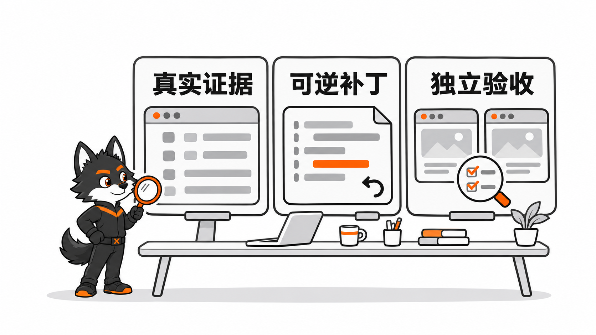
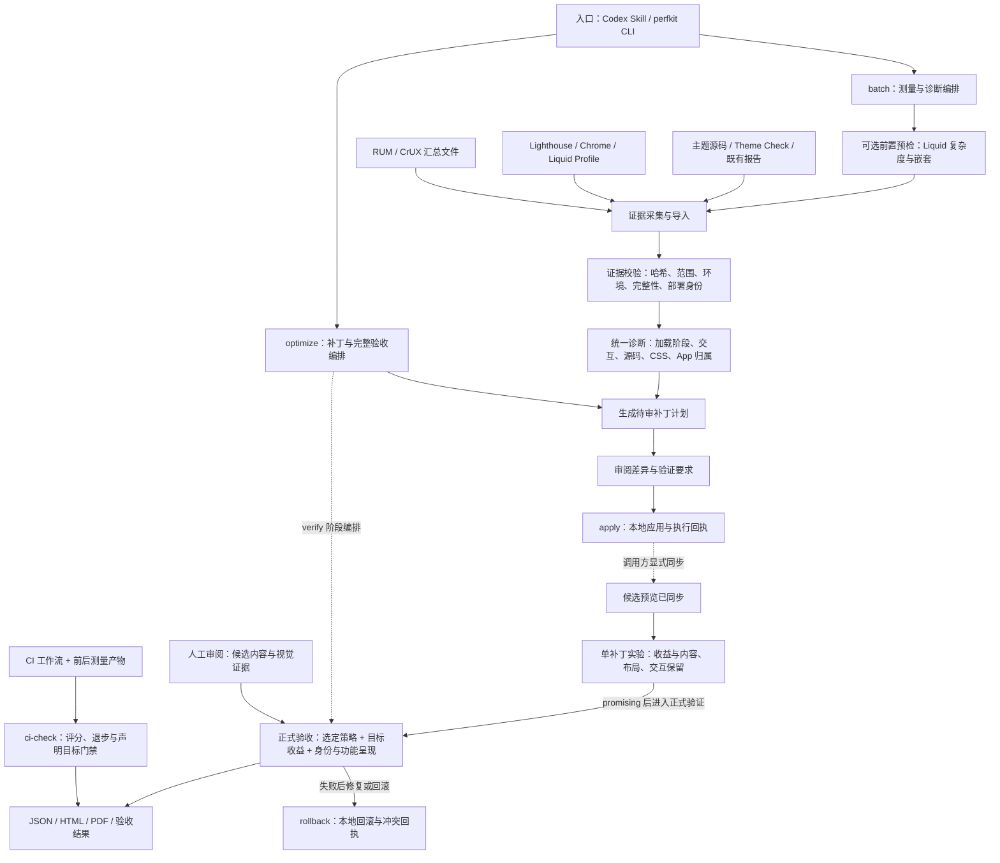

# Shopify 整站性能优化工具包

> 用真实证据定位瓶颈，用可逆补丁推进优化，用独立测量确认收益。



面向 Shopify Liquid 主题开发者的本地性能工具包。把主题源码、Chrome 运行采样、Lighthouse / PSI 测量与审阅记录串起来，帮助你回答：**哪里慢、该改什么、改完是否有效。** 可从 Codex 技能或 `perfkit` CLI 使用，输入为主题源码目录；主题 ZIP 需先解压。

**当前版本：0.20.0 · 2026-11-09** · [更新记录](CHANGELOG.md) · [完整命令](references/commands.md) · [安装与运行](#安装与运行)

未发布的规范对齐扩展：可显式选择 `acceptancePolicy: "standards-v1"`，按具体指标、项目 Theme Check 与改动范围证据验收；省略时保留旧分数流程。新增八项浏览器观察、PageOtter handoff v1 导入和处理清单报告。见 [第二、三批使用说明](references/standards-upgrade.md)。

本版增加 `theme-diff`、JSON 配置内嵌代码审计，并兼容 Shopify CLI 5 的检查输出；保持部署、正式采样、业务与视觉验收要求。详见 [主题整改证据与配置内嵌代码](references/theme-evidence.md)。

工具包拆分为两个可独立安装的工具包：**perfkit 负责性能与评分，seokit 负责源码 SEO 修复**。二者共用源码扫描、解析和指纹能力，发行包各自自包含。性能命令及验收保持兼容；SEO 可独立完成 plan → apply → verify → rollback，fix 可一次执行；无需 Lighthouse 或 Chrome。性能新增 request-implementation / plan-custom，将 Codex 编写的自定义代码接回原实测、回滚及正式验收流程。详见 [新功能使用流程](references/source-repair-workflow.md)。

- [SEO 工具包安装与使用](packages/seo/README.md)
- [两套工具的边界、配置和迁移](references/seo-toolkit.md)
- 同时构建：`npm run release:toolkits -- --out-dir /absolute/Codex-Outputs/new-release-directory`

本版新增渲染后 HTML 审查（`audit-html` / batch `renderedHtml`）、表单与焦点快照、购物交互场景，并将技能入口按任务精简。原正式实测、部署身份、回滚与验收门槛保留。用法见 [HTML 与快照](references/rendered-html.md)、[交互场景](references/interaction-scenarios.md)；新增复用来源见 [许可说明](THIRD_PARTY_NOTICES.md)。

## 六项能力，贯穿诊断到验收

| 能力 | 帮你解决的问题 |
| --- | --- |
| 统一排序 | 结合目标、证据和执行范围安排候选优先级，区分可执行补丁与待调查任务，不混比不同口径的耗时。 |
| 资源成本 | 按采样追踪请求、传输、CPU、源码引用和发起链，找到值得继续调查的脚本、样式与媒体。 |
| 资源健康 | 检查图片解码与 picture 实际选源；未触发、超时或采样不完整时保留未知状态。 |
| 字体闭环 | 从字体加载和文本几何证据生成待审配方，支持保留字体身份的 `font-display` 补丁。 |
| 豁免与归属 | 分开记录规则禁用与实际修复，核对生成器、App 和主题源码归属，建立可比的观察基线。 |
| 结构依赖 | 分析 section / block 设置、别名、动态访问与调用关系，为重构提供依据。 |

本版提供 **21 项通用代码策略**，包括 `liquid-font-display` 和 `liquid-rehost-resource`。候选进入既有的差异审阅、应用、回滚与验证流程；结构告警和资源耗时需要进一步验证，才能判断是否有性能收益。实现与兼容要求见 [资源、字体与归属规则](references/toolkit-evolution.md)。

## 怎样开始

1. **先诊断。** 安装依赖并运行 `doctor`；用 [batch 批处理](#默认用一次批处理) 串联测量与诊断，已有有效证据可以复用。
2. **再修改。** 选择瓶颈，生成并审阅补丁计划，本地应用后显式同步到候选预览。
3. **用实测决定下一步。** 小样本实验有收益后进入正式验收；无收益或发生回归则回滚、保留失败历史，再选择其他方案。[improve 会话](references/improvement-workflow.md) 可持续记录状态与预算。

正式验收同时检查目标收益、指标退步、部署身份、功能及内容视觉证据，两种策略均要求每页每设备前后各至少 5 次独立导航测量。省略 acceptancePolicy 保留旧流程：候选端移动最低 **75 / 中位 80**，桌面最低 **85 / 中位 90**，门槛可配置；显式 standards-v1 将分数仅作诊断，增加项目 Theme Check、范围观察和运行完整性证据。只声明 loading/interaction 不会切换策略，详见 [新旧验收策略](references/standards-upgrade.md#两种正式验收策略)。工具测试与隔离夹具验证不能代替商家主题实测，也不保证任意主题提分。

`batch` 编排测量与诊断；`optimize` 分阶段编排补丁与验收。主题预览同步由调用方显式执行。更多操作见 [代码优化工作流](references/site-workflow.md)，各层职责与完整流程见下文。

从 0.13.0 升级时需重建观察基线；归属记录必须绑定当前 `sourceHash`，资源替换需唯一字面 id 和新的运行证据。详见 [升级与验收边界](references/toolkit-evolution.md)。

## 当前架构与各层职责

根目录独立技能 [theme-code-generation](theme-code-generation/SKILL.md) 提供 [主题代码生成规范](theme-code-generation/theme-code-generation.md)，区分官方规则与项目预算，重点复核代码长度、复杂度、嵌套和重复。根目录 `AGENTS.md`、主技能及补丁文档已接入生成前阅读与生成后复核；技能目录可单独复制使用。此接入约束操作者流程，不代表 CLI 自动执行 Markdown 中的所有规则，也未安装到全局技能目录。

同一技能包含 [日常 Section 生产规范](theme-code-generation/section-production.md)：新建 Section 时先组织内容模型、主题复用和配置，再按规范编写 Liquid、CSS、必要 JS 与媒体加载，最后执行共享质量检查。无须先运行审计或提供已有代码。

工具包以本地 Node.js CLI 为核心，Python 承担评分汇总、PDF 与打包；证据、计划和执行回执通过文件串联。核心流程是：证据采集 → 诊断决策 → 可逆修改 → 分层验收。下图表示逻辑分层和主工作流，节点属于同一工具包；可选步骤按配置启用，部署身份检查贯穿测量前后。



“自动执行”指调用方提供配置并启动后由程序完成；审阅由用户或获授权的操作者完成。哈希校验不能代替业务、语义或视觉判断。

完整验收会重新校验计划及其前后文件；功能回归必须绑定候选源码、店铺/主题、页面/设备和实际完成的全部声明步骤，回归结束后再核验远端源码。缺少内容/视觉审阅时保留 `not-accepted`，可审阅已有产物后用 `verify-optimization` 复核，无需重跑 Lighthouse。旧回归记录缺少身份、稳定性或结束时间时需重新采集，不能补填通过字段；独立评分命令与旧流程的导航评分规则不变。

`npm run test:architecture`，用隔离主题将预检、batch、待审计划、apply、显式同步、单补丁实验、正式验证和审阅交接连通；审阅后继续验证 CI 与回滚。运行环境、两段命令及测试边界见 [架构端到端验证](references/architecture-e2e.md)。

| 层与职责 | 自动执行 | 需要人工审阅或外部操作 |
| --- | --- | --- |
| 入口与编排：CLI / Skill / batch / optimize | 校验配置、串行编排、控制预算、记录状态 | 确定目标、主题、页面/设备矩阵与业务状态 |
| 源码与结构：precheck / scan / audit-* / source-graph | 结构预检、源码清单、依赖图、代码/SEO/资源候选检查 | 复核动态引用、共享组件及业务影响；告警不等于性能收益 |
| 证据采集：measure / profile-* / measure-interactions / import-field | 真实导航与运行采集、交互重复采样、线上汇总文件导入 | 准备有效基线、预览 URL、登录/同意状态、线上字段与 App 归属映射 |
| 证据契约：run-evidence / lhr-contract / deployment | 校验完整性、环境、时间、哈希及测量前后部署身份 | 确认地区、内容、App 配置和机器负载等外部状态 |
| 诊断决策：diagnose-performance / audit-stylesheets / attribute-apps | 关联源码、按目标和对应线上影响排序、输出策略建议 | 确认关键路径、因果关系、复杂 CSS 依赖和 App 用途 |
| 补丁执行：plan-site / plan-demand / plan-split / apply / rollback | 对支持模式生成差异、检查漂移、应用和回滚本地文件 | 审阅 diff、证据与验证范围；复杂替换由操作者准备；显式同步预览 |
| 实验与验收：experiment / scenarios / verify-* / ci-check | 重复测量、断言、checkpoint 比较、收益/退步及身份检查 | 选择有意义的交互断言，完成内容视觉审阅及所需业务验证 |
| 输出：summarize / report / report-pdf | 生成摘要、JSON、HTML、PDF 和回执 | 判断未测项、待复核项与交付范围 |

`batch` 可生成待审计划并执行评分检查，不应用补丁；`optimize` 分 prepare/apply/verify 推进，预览同步是外部步骤。诊断绑定计划的正式验收必须重算单补丁证据；其他计划可先做探索验证。时间/尝试/失败预算、源码漂移检查、历史早停和回执记录贯穿各层。

## 各阶段的验收标准

| 阶段 | 通过条件与边界 |
| --- | --- |
| 结构预检与诊断 | 启用预检时，官方两规则执行完整、无告警才可标为预检通过；缺少规则支持或运行失败终止该 batch。候选须关联当前源码与实际耗时；告警、动态依赖和未知归属独立保留待复核 |
| 采集与证据 | 前后引擎、页面/设备矩阵和环境可比，保留原始报告及失败；完整优化的测量前后部署身份已核验。缺测、运行警告、重复/无效样本或源码漂移不自动通过 |
| 计划、应用与预览 | 审阅差异和验证要求，计划与当前源码匹配；以成功 receipt 确认本地应用，再由调用方同步预览并核验候选身份 |
| 单补丁实验 | 一个假设、一个代表页面/设备、源码差异仅含计划；导航前后交替各 3 或 4 次；目标收益成立、无关键指标退步、双侧内容/几何/样式/交互保留，才是 promising，仍需正式验收 |
| 正式优化验收 | 每页每设备前后各至少 5 次导航样本；按选定策略检查声明收益、无关键指标实质退步、前后身份、功能覆盖与源码绑定的内容视觉审阅；旧流程另要求评分门槛，standards-v1 另要求规范证据，全部必要项通过才是 optimization-accepted |
| CI 与交付 | CI 的 passed 表示回归门禁通过；默认 score 可持平，loading/interaction 另需目标收益。报告分别展示评分、完整验收、待复核及未测项；回滚后仍须显式同步预览 |

旧流程默认 `score` 要求可测分数提升；`loading` 要求声明的 LCP/FCP/TBT/CLS/SI 收益；`interaction` 另需每侧 5–10 次完整、独立、不重叠的交互采样，与导航源码/店铺/主题/页面/设备一致，并对目标执行同类 click/press 后紧接 UI 断言。旧流程三种目标均保留原导航评分与退步检查，95→80 即使达到门槛仍不通过。显式 standards-v1 只接受 loading/interaction，分数仅作诊断，具体指标退步保护与独立交互要求继续有效。

详细模块映射、阶段状态、默认收益下限、数据契约与 CI 接入见 [架构与验收说明](references/evidence-driven-architecture.md)。

0.11.1 二次审计补齐交互执行/独立性/部署范围门禁、目标交互 UI 断言与键盘回归；修复线上元素范围匹配、CSV 空值和布局会话边界。旧交互记录缺少新增动作时间与目标信息时须重新采集；原导航评分数据与默认 score 流程继续可用。

## 能力与输出

| 命令 | 用途 |
| --- | --- |
| `improve` | 带历史与预算的 start/refresh/reprofile/prepare/apply/sync/experiment/collect/verify/rollback 会话；无收益回滚重诊断，支持已验证的低分中间基线 |
| `import-field` | 规范 RUM/CrUX JSON 和汇总 CSV 导入，保留时间、设备、国家、p75 与未知样本范围 |
| `audit-stylesheets` / `attribute-apps` | 原生样式作用域兼容检查；按审阅映射归属资源与分阶段 CPU |
| `measure-interactions` / `verify-interactions` | 哈希绑定、部署包围、独立重复 Event Timing 采样与目标交互收益 |
| `ci-check` | 明确基线/候选的原评分与退步门禁，可叠加目标收益 |
| `source-graph` / `diagnose-performance` | 模板→组件→资源依赖图；正文/AST 核验的 JS、静态内联脚本 CPU 定位，保留未关联及低收益线索 |
| `plan-demand` | 自动提取自定义元素及私有依赖，按实际 Liquid 组件加载；根据多状态覆盖率生成关键 CSS，保留完整样式回退 |
| `experiment` / `verify-patch` | 一个假设、精确补丁差异、交替采样、目标耗时与分数收益、失败历史及早停 |
| `verify-preservation` | 比较 scenarios 的 checkpoint：内容、媒体引用、表单值、几何尺寸、计算样式和相同交互断言 |
| `profile-runtime` | Chrome CPU 调用栈、trace、JS/CSS 覆盖率、请求发起链、LCP 分段、源码正文哈希映射 |
| `profile-devtools` / `profile-liquid` | 官方 Chrome DevTools MCP/LCP skill、Shopify Liquid 服务端分析 |
| `plan-split` / `optimize` | CSS 拆分、组件首次交互加载、新资产可逆创建；prepare/apply/verify 分阶段闭环 |
| `verify-deployment` / `verify-gain` / `verify-optimization` | 候选身份、实测目标收益和关键指标退步拦截；完整验收按所选策略结合功能、视觉及适用的规范证据 |
| `batch` | 串行导入规范报告、分析外链/脚本、测量、审计与评分验收；共用预算 |
| `summarize` / `evaluate-iteration` | 离线精简摘要、全部候选收益与早停判断 |
| `doctor` | 检查本机依赖与测量配置 |
| `scan` / `inspect` | 全主题资源/模板清单及文件级候选问题 |
| `precheck` | 官方 Liquid 复杂度/控制流嵌套预检，源码快照、路径解释、PageFly/共享组件待复核线索 |
| `import-check` | 导入 Theme Check 或报告陈述，保留告警、校正依据及同口径基线差异 |
| `audit-quality` | 代码、SEO、JS/CSS 语法树、架构与能力覆盖分析 |
| `audit-resources` | 外链清单、可选 HEAD 核查、脚本加载及依赖候选 |
| `capture` / `map` | 浏览器证据与 Liquid 源码候选关联 |
| `measure` | 按页面 × 设备串行执行真实 Lighthouse 或 PSI，保存原始报告和失败记录 |
| `audit-site` | 联合源码与实测，定位 LCP、主线程、第三方及资源机会 |
| `code-strategies` / `analyze-code` | 列出可执行策略，分析指定代码文件的结构候选和拒绝原因 |
| `plan-site` | 根据代码策略、图片策略或已审阅替换生成多文件补丁 |
| `apply` / `rollback` | 指纹校验、逐文件原子写入、回滚及失败恢复记录 |
| `scenarios` / `verify` | 显式交互断言、内容与几何回归 |
| `verify-site` | 校验完整测量矩阵，逐页逐设备检查评分门槛 |
| `report-pdf` | 按参考版式生成 A4 PDF，附问题编号、文件、行号、代码及可选前后实测；[使用说明](references/pdf-report.md) |
| `report` | HTML 报告，保留完整 JSON 证据 |
| `plan-image` / `plan-component` | 单图和单组件工作流 |
| `lighthouse` / `score-target` | 汇总、验收已有原始 Lighthouse 报告 |

静态结果是候选；资源同名不等于已确定源码位置。围绕声明目标安排优先级，评分诊断使用指标加权丢分和版本匹配的评分曲线，Lighthouse 机会估值不相加。21 项 [可执行代码策略](references/code-strategies.md) 和两类拆分计划生成真实补丁；每项仍需结合主题逻辑和页面证据审阅，不支持的模式明确拒绝。旧流程中 95 分降到 80 分会被退步门槛拒绝；两种策略都不能用单纯“分数达标”冒充“优化已验收”。

## 安装与运行

需要 Node.js **22.19+**、Python **3.9+**。在工具目录安装锁定的解析器及 Lighthouse 13.5.0：

```sh
npm ci --ignore-scripts
export PERF_KIT_BROWSER_EXECUTABLE="/absolute/path/to/chrome"
node scripts/perfkit.mjs doctor
node scripts/perfkit.mjs --help
```

工具自动查找本机常见 Chrome 路径，也支持 PERF_KIT_BROWSER_EXECUTABLE / CHROME_PATH 显式覆盖。采集和场景回归已内置 Playwright Core；可用 PERF_KIT_PLAYWRIGHT_MODULE 指定其他绝对模块路径，PERF_KIT_PYTHON 指定 Python。依赖安装在工具目录，不下载浏览器。

复制 [测量配置](assets/examples/measurement.json)，填入真实首页、商品页、集合页等地址。选择 PSI 时将 engine 改为 psi，使用公开可访问页面；API key 仅通过 PERF_KIT_PSI_API_KEY 环境变量传入。PSI 无法访问本地地址或绕过店铺密码。两种引擎不会自动替换。

## 默认用一次批处理

默认单 agent、串行测量，终端只给约 4 KiB 摘要；完整报告与失败留盘。复制 [batch.json](assets/examples/batch.json) 后填入真实路径/地址。基线省略 before；候选必须先同步到预览，再填真实 baseline 的 measurement 目录。

```sh
node scripts/perfkit.mjs batch --config /absolute/batch.json --out /absolute/new-run
```

标准模板用 `"checks": {"run": true}` 调用已安装的 Shopify CLI，按主题的 `.theme-check.yml` 执行官方源码检查。可单独运行 `check-theme --project /absolute/theme --out /absolute/run/checks.json`。已有报告可用 [batch-with-checks.json](assets/examples/batch-with-checks.json) 导入。诊断 JSON/HTML 附入整站报告，`reviewRequired` 与 Lighthouse/PSI 评分分别记录，待复核时即使评分达标也返回 3。详见 [规范报告](references/code-quality.md)。

提供 project 时默认离线分析外链与脚本。`resources.probe=true` 才发送探测请求，`resources=false` 可关闭资源分析。

默认预算为一小时、80 次尝试、batch 最多 3 次失败、2 轮候选。时间/尝试耗尽保留部分证据并标为 stopped，不能通过验收。新增候选先用 [exploration.json](assets/examples/exploration.json) 小样本探索；低收益早停只限制继续探索，**不降低正式每组前后各 5 次，也不改变已选定的验收策略**。旧流程的 75/80、85/90 门槛保持兼容。完整配置、模型 token 计量边界、续轮 history 和离线导入见 [执行协议](references/execution.md)。

## 一次完整优化

以下为逐步命令，适合必要的定点调试；正常整站任务优先 batch。以下路径均为占位符；建立独立运行目录，输出文件和测量子目录必须尚不存在。

用于完整优化验收时，前后 measurement 配置均启用 deployment，核验必须包围各自采样；不能事后为旧基线补填身份。诊断绑定计划先完成匹配的单补丁实验，goal 与正式验证保持一致。

```sh
node scripts/perfkit.mjs scan --project /absolute/theme --out /absolute/run/scan.json
node scripts/perfkit.mjs measure --config /absolute/run/measurement.json --out /absolute/run/before
node scripts/perfkit.mjs audit-site --project /absolute/theme --run /absolute/run/before --out /absolute/run/audit.json
node scripts/perfkit.mjs report --input /absolute/run/audit.json --out /absolute/run/audit.html
node scripts/perfkit.mjs plan-site --project /absolute/theme --recipe /absolute/run/recipe.json --out /absolute/run/plan.json
node scripts/perfkit.mjs apply --project /absolute/theme --plan /absolute/run/plan.json --out /absolute/run/apply.json
```

根据 audit 选择瓶颈，准备 [补丁 recipe](references/site-patches.md) 并审阅 diff。应用只修改本地源码；**确认预览页面已同步候选源码**后，用相同页面、设备、业务状态和配置复测。工具不自动 push/publish。

```sh
node scripts/perfkit.mjs scenarios --config /absolute/run/scenarios.json --out /absolute/run/scenarios-after
node scripts/perfkit.mjs measure --config /absolute/run/measurement.json --out /absolute/run/after
node scripts/perfkit.mjs verify-site --before /absolute/run/before --after /absolute/run/after --out /absolute/run/verification.json
node scripts/perfkit.mjs report --input /absolute/run/verification.json --out /absolute/run/verification.html
```

这里的 verification.json 是原评分检查结果；即使使用 standards-v1，verify-site 本身仍按原评分契约运行。已有完整证据时，按 [执行引擎](references/performance-engine.md) 准备含 before/after、expectedSourceHash、regression、review 及所需 plan/patchEvidence/goal/interactionEvidence 的验证配置；新规范流程另外按 [策略说明](references/standards-upgrade.md#两种正式验收策略) 提供 acceptancePolicy、standardsEvidence 和部署绑定的 integrityProfiles，再进行完整验收：

```sh
node scripts/perfkit.mjs verify-optimization --config /absolute/run/optimization-verification.json --out /absolute/run/optimization-result.json
```

只有 optimization-result.json 的 outcome 为 optimization-accepted 才表示声明范围内完整优化通过。使用分阶段编排时，按 [optimization-verify.json](assets/examples/optimization-verify.json) 填写真实配置并运行 optimize；该模板用于 optimize verify，不直接作为 verify-optimization 输入。

功能或画面回归时修复或回滚；未达标时按剩余瓶颈继续小批修改：

```sh
node scripts/perfkit.mjs rollback --project /absolute/theme --plan /absolute/run/plan.json --out /absolute/run/rollback.json
```

多文件操作不是跨文件事务。全部文件先预检，失败时尝试恢复已写入文件；并发修改或恢复失败会留下明确 receipt。评分通过仅表示这批实验室样本达标，功能、画面和真实用户 CWV 需要各自证据。

## 使用资料

- [主题性能八步流程](references/theme-performance-workflow.md)、[P0/P1 规则](references/shopify-performance-rules.md)、[单补丁实验与验收](references/performance-engine.md)
- [官方知识库与可执行补丁](references/shopify-knowledge.md)、[实际查阅的恢复资料](references/shopify-recovery-sources.md)
- [查询、隐藏 DOM、Section Rendering 与 Liquid 首屏](references/extended-optimization.md)
- [图片、CLS、Liquid 与 App 优化](references/domain-optimization.md)
- [报告接入、误报校正与资源依赖](references/code-quality.md)
- [完整命令](references/commands.md)、[整站工作流](references/site-workflow.md)、[测量约定](references/measurement.md)
- [多文件补丁](references/site-patches.md)、[单文件补丁](references/changes.md)
- [评分验收](references/score-acceptance.md)、[浏览器验证](references/verification.md)、[业务验收](references/acceptance.md)
- [自动化边界](references/automation.md)、[更新记录](CHANGELOG.md)

真实测速正常加载页面脚本和请求；capture/scenarios 限制写请求，其通过不能证明真实支付、加购、统计或 App 写操作通过。

## 开发、验证与发行

```sh
npm run test:p0p1
npm run test:execution # 执行、批处理、测量及验收回归
npm run test:demand
npm run test:boundaries # 单独运行架构依赖检查；原 test:architecture 仍为端到端验证
npm test # 同 test:offline；不启动 Chrome 或真实 Theme Check
npm run test:lighthouse
npm run test:browser # 自动发现全部 *-browser.test.mjs，串行执行
npm run test:official # 已安装 Shopify CLI，对隔离本地主题运行 Theme Check
npm run test:release # 以上四组依次检查；不构建、上传或发布
npm run test:site
npm run release -- --out /absolute/Codex-Outputs/shopify-perf-toolkit-v0.17.0.zip
```

| 测试 | 运行条件 | 失败标准 |
| --- | --- | --- |
| 架构和离线 | Node.js 22.19 或更高、Python 3，以及监听 `127.0.0.1` 的权限。`test:offline` 包含架构检查，也可用 `test:boundaries` 单独运行。 | 架构检测到循环或越层、架构套件缺失或有跳过、任一命令非零退出。离线 Node 组保留平台相关跳过，Python PDF 用例在缺少可选渲染依赖时跳过。 |
| 浏览器 | 已安装的 Chrome/Chromium、playwright-core 和本地 HTTP 夹具。测试串行运行，仅启用 `PERF_KIT_BROWSER_TESTS`。 | 依赖预检失败，或出现用例失败、跳过、TODO、空结果或缺少汇总。 |
| 官方校验 | 已安装的 Shopify CLI，需支持 `--no-input`、`--list`、`--print`。Theme Check 对隔离本地主题运行，测试串行运行，仅启用 `PERF_KIT_THEME_CHECK_TESTS`。 | CLI 缺失或能力不足，或出现用例失败、跳过、TODO、空结果或缺少汇总。夹具中的预期 Shopify 告警按测试断言验证。 |

`test:offline`、`test:browser`、`test:official` 按测试文件名分组，隔离外部继承的启用开关。Node 入口通过时退出 `0`，断言失败、用例取消、TODO、任一测试文件没有实际用例结果或汇总不完整时退出 `1`，依赖预检受阻、启用 Node 测试筛选参数或入口配置有误时退出 `2`。可用 `node scripts/run_tests.mjs browser --list` 查看分组文件。本地使用 `PERF_KIT_BROWSER_EXECUTABLE` 或 `PERF_KIT_SHOPIFY_CLI` 指定已安装程序的绝对路径，测试入口本身不安装依赖。

`test:lighthouse` 是 Python 汇总、评分与打包测试。`test:site` 使用隔离测试主题，运行首页和商品页、移动和桌面、修改前后各 5 次，共 40 次真实 Lighthouse，并验证补丁、交互、内容和回滚。它需要 Chrome 和 Playwright。

项目仅保留最新工具源码、测试、使用文档、配置模板和运行依赖。报告、测量结果、主题快照与回滚资料通过输出路径保存到工具目录之外的独立任务目录；工具目录不保留这些任务数据或生成的发行包。

需要发行 ZIP 时必须按上述命令显式指定仓库外的新 ZIP 路径；白名单包含源码、测试、说明、配置示例及 lockfile，排除 node_modules、报告、回滚资料和其他 ZIP，解压后运行 npm ci --ignore-scripts。全局 Skill 入口可指向同一个工具目录，使 Skill 与 CLI 共用源码和依赖。

### 代码、SEO 与分析型 PDF

`audit-quality` 增加 SEO 源码引用分析、JS/CSS 语法树检查、嵌套路径、重复 schema 与可访问性线索；batch 显式配置 `quality: true` 接入。`report-pdf` 自动使用这些能力，按参考专项报告结构组织根因、代码例子、整改与验证，完整数据另存 JSON。检测覆盖、解析失败和线上待验证项单独展示。见 [PDF 报告契约](references/pdf-report.md)。

### Liquid 前期预检

在现有 batch 配置中增加 `precheck: true`（需要 Shopify CLI），即可在测量前检查 LiquidComplexity / LiquidNestingDepth，默认 120 / 10。使用独立两规则配置，不继承主题忽略项；支持显式阈值。报告保留官方结果与本地解释，待复核状态与性能评分分开。单独只读检查用 `precheck --project /absolute/theme --out /absolute/run/precheck.json`。详见 [预检流程](references/precheck.md) 与 [批次示例](assets/examples/batch-with-precheck.json)。

恢复执行与正式采集：[`improve-cycle`](references/recovery-cycle.md) 复用持久会话，在无收益后重新诊断、生成另一份已审阅机制的补丁、同步核验预览并实测。资源预算按每页面/设备/采样核对真实字节和请求数，缺失证据不放行。

架构与恢复闭环：正式证据采集、最终验收和会话状态链已分离；无收益后会同步回滚基线、重新采集源码绑定的运行时/Liquid 证据，再诊断、生成其他机制的补丁并按原门槛验证。官方方法支持审阅后续跑，详见 [恢复闭环](references/recovery-cycle.md)。

0.19.0 新增 [LCP 身份与重复加载检查](references/runtime-integrity.md)：浏览器采集、离线重算、全流程报告和可选部署绑定验收门禁。无异常仅限已观察窗口；旧报告缺字段显示未检测。


## 0.20 跨主题交付与持续治理

见 [交付能力、标准及迁移说明](references/delivery-governance.md)。复用现有 plan/apply/experiment/verify；新增能力档案、适配器、业务证据接入、窗口预算、增量工程规则及现场汇总趋势。`delivery-v1` 为显式选择的加强门禁，旧流程不被默认为已验证新能力。

`npm run validate:delivery -- --out /absolute/external/new-run` 保存绑定包指纹的完整回归记录；`npm run release -- --out /absolute/external/toolkit.zip` 输出附哈希清单的源码包。商家主题与现场收益仍需独立验证。
