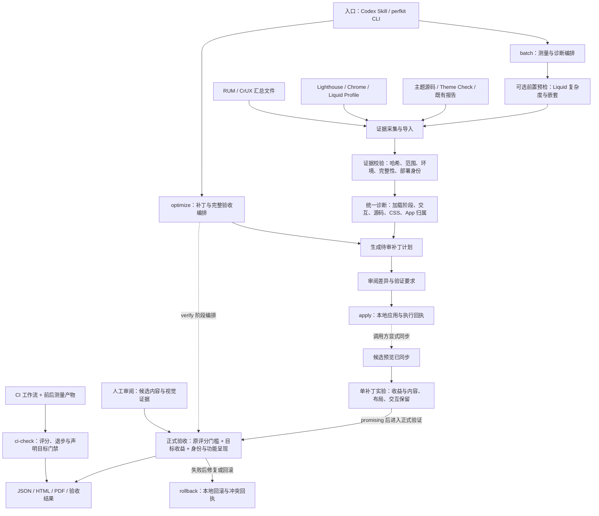

# 当前架构、职责与阶段验收（0.11.1）

本文保留 0.11.1 的旧流程架构与阶段契约，适用于省略 acceptancePolicy 的配置。默认仍是 `score`：正式每页每设备前后各至少 5 次，候选端移动每次最低 75/中位 80，桌面 85/90，警告、可比性、部署身份、指标退步、功能与内容视觉要求不降低。旧流程中新增 loading/interaction 目标只改变“需要证明哪项收益”，不关闭原导航评分门槛。

当前显式 standards-v1 的正式验收差异以 [新旧验收策略](standards-upgrade.md#两种正式验收策略) 为准：分数只作诊断，增加规范证据门禁，其余共同保护保留。下文的原评分门槛和 95→80 拒绝示例描述旧流程；batch、CI 和单补丁实验仍沿用各自原契约。

## 逻辑架构

系统由本地 Node.js CLI 驱动，Python 承担原评分汇总、PDF 与发行打包，Chrome/Playwright、Lighthouse/PSI、Shopify CLI 提供相应采集与检查能力。工具使用文件保存证据、计划、回执与报告；RUM/CrUX 是汇总文件导入入口，当前没有持续在线采集服务。

下图表示同一工具包内部的逻辑分层及推荐工作流，不表示一次命令会调用所有节点。预检、采集与诊断按配置启用；部署身份核验实际发生在测量前后。单补丁实验由独立 experiment 命令执行，诊断绑定计划的正式验证会重算其证据。



## 各层职责与实现

下表未标路径的 `.mjs` 模块位于 `lib/`；CLI 与 Python 渲染/打包脚本位于 `scripts/`。命令参数和配置示例通过对应文档链接查看。

| 层 | 职责与主要实现 | 主要产物 |
| --- | --- | --- |
| 入口与编排 | `scripts/perfkit.mjs` 分发命令；`SKILL.md` 定义操作者工作流；`batch.mjs` 编排测量诊断；`optimize.mjs` 分阶段准备、应用和完整验证 | batch/optimization 状态、步骤与产物索引 |
| 源码与结构检查 | `precheck.mjs` 官方两规则预检；`scan.mjs` 清单；`quality-audit.mjs` 代码/SEO；`resource-audit.mjs` 外链和脚本；`source-attribution.mjs` 依赖图与正文/AST 归因 | precheck、scan、quality、resources、源码图与待复核项 |
| 证据采集与接入 | `measure.mjs` 导航采样；`runtime-profile.mjs` CPU/trace/覆盖率；DevTools/Liquid profile；`interaction-measure.mjs` 重复交互；`field-data.mjs` 汇总导入 | run.json、原始 LHR、profile/trace、interactions.json、field.json |
| 证据契约 | `evidence-contract.mjs` 范围和哈希；`run-evidence.mjs` 测量目录与矩阵；`lhr-contract.mjs` 报告环境；`deployment.mjs` 远端文本源码与页面身份 | 校验结论、源码/manifest 指纹、测量前后 deployment proof |
| 诊断决策 | `bottlenecks.mjs` 源码绑定假设；`decision-engine.mjs` 阶段/目标/线上范围排序；`score-impact.mjs` 评分影响分析；样式兼容和 App 归属模块 | 候选 ID、源码位置、观测成本、优先级、策略建议与限制 |
| 补丁执行 | `code-strategies.mjs` 支持模式改写；`demand-plan.mjs` 组件/多状态关键 CSS；`split-plan.mjs` 拆分；`site-changes.mjs` 多文件计划、应用、回滚 | plan、diff、前后源码/计划指纹、apply/rollback receipt |
| 实验与验收 | `patch-experiment.mjs` 单假设；`scenarios.mjs` 动作/断言/checkpoint；`preservation.mjs` 保留性；gain/site/interaction 验证器；`optimization-regression.mjs` 完整功能证据校验；`optimize.mjs` 完整验收；`ci-check.mjs` 回归门禁 | promising、评分结论、收益/退步、功能结果、完整验收或 CI 结果 |
| 输出与交付 | `summary.mjs` 精简摘要；`report.mjs` HTML；`pdf-report.mjs` 与 Python 渲染器生成 PDF；`build_release.py` 源码包 | JSON、HTML、PDF、执行回执与源码发行包 |

`execution-policy.mjs` 的预算与计量接口、`bounded-process.mjs` 的子进程边界、历史/早停规则、源码漂移检查和失败回执贯穿上述层次。模型 token 预算依赖调用方提供可信计量，CLI 自身不调用模型。

### 两条编排流程

- `batch`：可选 precheck → 线上/样式/规范报告接入、资源与质量检查 → 配置的 runtime/Liquid/DevTools 剖析 → 测量或复用已有 run → 统一诊断及 demand 待审计划 → 整站报告与原评分检查。显式 recipe 计划在测量前生成；两种计划均不应用。一次对应一个已部署源码版本；显式 goal 用于诊断选题，batch.acceptance 仍是原评分检查结果，完整目标验收使用 optimize/verify-optimization。
- `optimize`：prepare 生成计划 → apply 检查 reviewedPlanHash 并应用本地修改 → 调用方显式同步预览 → verify 核对候选、实验记录、正式导航、功能与内容视觉证据。三个 action 分开调用；verify 不会替调用方同步预览，也不会自行准备两侧交互记录。

诊断绑定计划必须提供相同 goal、相同前后源码且可重算为 promising 的 patchEvidence。其他计划可先做探索验证；探索配置不会降低正式门槛。`experiment` 读取调用方明确准备好的基线和候选预览，交替采样，不创建或同步预览。

## 自动执行与人工审阅边界

“自动”指显式启动命令、提供有效配置且满足前置条件后由程序执行。审阅可由用户或获授权的操作者完成；审阅记录和哈希不是用户身份签名，也不会把业务判断变成自动证明。

| 工作 | 自动执行内容 | 需要人工审阅或外部操作 |
| --- | --- | --- |
| 定义任务 | 校验配置、目标和路径 | 选择主题、页面/设备矩阵、业务状态、基线与验收范围 |
| 结构和质量检查 | 官方规则执行、AST/资源分析、候选及异常落盘 | 复核动态依赖、共享范围、复杂 CSS、PageFly/App 行为和误报；不按告警数量推断提速 |
| 导航与交互采集 | 串行独立采样、原始证据与失败保存、预算检查 | 准备稳定 URL、CLI 登录、同意/登录状态和必要的预览访问条件 |
| 线上证据与 App 归属 | 校验导入窗口、p75、样本数/元素范围；按显式映射分组 | 提供真实汇总、正确字段与共同样本口径；复核 host/path 对应的 App 和用途 |
| 诊断与计划 | 关联当前源码、排序、对支持模式生成补丁和拒绝原因 | 确认耗时的因果关系、策略和业务影响，准备复杂替换，阅读 diff 与 verificationRequired |
| 本地写入与同步 | apply/rollback 预检、逐文件原子写入、冲突和恢复回执 | 启动已审阅计划；在工具外同步指定预览并确认内容与主题；回滚后同样需要同步 |
| 自动功能检查 | 执行已声明的 click/press、断言、checkpoint 与保留性比较 | 设计能证明目标功能的断言；复核内容/视觉；需要时另行验证实际业务写操作 |
| CI 与交付 | 消费已有完整产物、重算门禁、生成报告 | 在主题仓库接通上游采样/artifact；处理待复核和未测项，决定后续同步或发布 |

受限 capture/scenarios 通过不能证明加购、统计、支付等写操作。CSS 审计是静态补充检查，复杂动态规则需官方 Theme Check 与运行验证；App 未知/歧义归属仍待复核。预检、CSS/App 告警独立记录，不修改原评分规则，也不会被完整优化验证器自动认定已解决。

## 各阶段的进入条件与验收标准

| 阶段 | 自动检查与通过标准 | 人工检查和失败处理 |
| --- | --- | --- |
| 1. 范围与基线 | 路径/配置有效，明确源码、URL、矩阵、goal；复用与当前任务匹配的真实历史证据 | 确认内容、地区、同意/App 状态；缺少匹配基线则补采，不以候选替代基线 |
| 2. 可选结构预检 | 官方两规则、版本、生效配置、源码快照完整且无告警，才可称该预检通过；默认复杂度 120、控制流嵌套 10，等于阈值不告警 | 规则不支持或执行失败停止 batch；告警/解释不完整保留 reviewRequired/partial，不能称性能不达标或自动修复完成 |
| 3. 采集与契约 | 报告结构、URL、设备、时间和环境有效；前后同引擎/版本/配置、完整矩阵、独立样本；完整优化另需测量前后 deployment verified | 运行警告、不受控环境、缺测、重复/无效证据或身份漂移不得自动通过；保留失败，不挑高分样本 |
| 4. 诊断选题 | 可进入补丁的假设须绑定当前源码的正文/AST 证据和实际观测成本；线上窗口/指标/元素范围匹配；保留不支持及未知项 | 确认关键路径和业务可改性；candidates-ready 仅表示可调查，仍检查独立 reviewRequired，不等于允许盲目修改 |
| 5. 计划与本地应用 | 计划通过校验、文件前后指纹和当前源码一致；optimize apply 核对 reviewedPlanHash；正式 verify 再验完整计划及基线/候选文件；成功 receipt 才表示应用完成 | 审阅 diff、依赖、保护项和验证范围；漂移则重读重建；部分恢复或冲突依 receipt 处理，不改哈希绕过 |
| 6. 预览同步与身份 | verify-deployment 以远端文本源码及页面主题/店铺身份核验；采样轮前后必须包围同一源码版本 | 调用方在工具外同步；本地 apply 成功或 CI commit 标签不等于预览已部署 |
| 7. 单补丁实验 | 一个假设、一个代表页面/设备，前后差异仅含计划；runner 每侧 3 或 4 次交替导航采样；双侧 checkpoint/断言保留，目标指标改善且无关键指标退步才为 promising | JS 补丁需 click/press 紧接 UI 断言并保留响应时间；interaction 另需重复交互收益及双侧目标操作覆盖。无效证据、无收益、功能/性能退步分别记录，遵循 history/预算停止 |
| 8. 正式导航门槛 | acceptance 用途，每页每设备前后各至少 5 次；候选端移动每次最低 75/中位 80，桌面每次最低 85/中位 90；所有组可比、无阻止通过的告警和关键指标退步 | 基线用于可比性与收益检查，不要求其原分数已达候选门槛。声明矩阵全部完成；未测页面/状态不外推。verify-site 的 score-targets-met 不代替部署身份、功能或完整优化验收 |
| 9. 完整优化验收 | 原导航门槛、相应 goal 收益、前后同店铺且不同源码、候选等于 expectedSourceHash、功能覆盖及 review 全部通过；诊断绑定计划还需匹配的 promising 实验；传入 plan 时核对计划文件与实测源码 | 候选 scenarios 的完整声明矩阵与全部步骤通过，源码稳定且店铺/主题一致，无受限请求/页面错误/文档切换；远端核验的开始时间不得早于回归结束。内容/视觉 review 绑定候选哈希且明确保留；缺失时 not-accepted，审阅后可复核已有证据 |
| 10. CI 回归 | 明确且不同的前后 run 与完整 commit SHA；原评分/退步通过。score 可持平；loading 另需收益；interaction 另需收益及与导航完整身份/范围匹配 | 缺失/不可比证据不通过；passed 仅为 CI 门禁结果，不证明完整功能呈现或完整优化验收 |
| 11. 报告与回滚 | 保存原始证据、摘要、评分/目标/完整验收、待复核/未测与 receipt；本地回滚以当前指纹和回执确认 | 复核交付范围；冲突不覆盖外部修改。远端恢复由调用方显式同步，未同步不称预览已恢复 |

正式验收中的“无关键指标退步”覆盖分数和 LCP/TBT/CLS/FCP/SI；按最低变化量与前后 MAD 噪声带判断，不把单次波动等同于确定退步。具体收益阈值见下文。结构/静态告警的关闭、阶段完成、评分达标、promising、CI passed 与 optimization-accepted 分别记录，不能相互替代。

## 命令入口与运行依赖

| 入口 | 内容 | 是否修改主题 |
| --- | --- | --- |
| import-field | 导入规范 JSON、汇总 CSV、CrUX API record 或已有 field-evidence | 否 |
| diagnose-performance | 合并原诊断、阶段筛查、交互 CPU、线上范围、样式策略及 App 归属 | 否 |
| audit-stylesheets | 检查原生 stylesheet 作用域依赖，输出策略建议 | 否 |
| attribute-apps | 按人工复核的 host/path 映射展示资源与分阶段 CPU 成本 | 否 |
| measure-interactions | 连续创建全新浏览器上下文采样，前后核验部署；保留原始 profile/trace | 否 |
| verify-interactions | 重读哈希绑定的原始记录，比较同一目标交互 | 否 |
| ci-check | 对明确基线/候选执行原导航门槛与退步检查，可叠加目标收益 | 否 |

所有输出路径必须不存在。报告和任务数据仍放在工具目录外。CLI 不调用模型，不同步/发布主题，不下载额外素材。

源码与离线报告分析使用本地文件；运行采集使用已有 Chrome/Playwright，导航测量选择 Lighthouse 或公开 URL 的 PSI；官方预检、Liquid 分析和部署文本核验需要对应 Shopify CLI 能力及授权。依赖或证据不可用时明确报告受限，不用其他类型数据补造通过结果。完整参数见 [命令说明](commands.md)，预检覆盖见 [precheck](precheck.md)。

## 线上数据导入与选题

```sh
node scripts/perfkit.mjs import-field --input /absolute/task/export.json --out /absolute/task/field.json
node scripts/perfkit.mjs diagnose-performance --project /absolute/theme --profiles /absolute/task/profile-paths.json --field /absolute/task/field.json --owners /absolute/task/app-owners.json --goal /absolute/task/loading-goal.json --out /absolute/task/diagnosis.json
```

格式见 `assets/examples/field-export.json` 与 `.csv`。所有指标均声明为 **p75**；LCP/INP/TTFB/FCP 单位 ms，CLS 无单位。导出 CSV 是工具规范的汇总表，不是自动识别所有 Shopify 后台导出列名；对原始后台报告需显式映射这些字段。CrUX 直接接受 `record.key`、`record.collectionPeriod.firstDate/lastDate`、`metrics.*.percentiles.p75`；不接收缺少时间范围的 PSI field 摘要冒充完整 record。

samples 必须对应所列指标的人群；各指标计数不同而无法确认共同下限时保留 null，不把页面访问数直接当作交互样本数。

默认窗口结束距导入时间最多 35 天，已知样本至少 100 才标记 usable；这是工具的选题策略，不是 Google 样本门槛。CrUX 未公开样本数时保留 null、limited；仍展示问题线索，不伪造样本数。日期、重复分组、非法指标、带查询/凭据的 URL 会被拒绝。示例是合成数据，使用前必须替换日期、URL、计数和指标。

URL/Origin、模板类型、设备、国家和元素范围分别保留，不把多个 p75 平均，不相加不同国家或重叠总体的样本数。匹配只使用相同域名路径/明确 Origin，预览 query 不参与匹配；不会猜测 myshopify 预览域与自定义域的对应关系。无线上数据仍可诊断，fieldStatus 保持 unavailable。

元素分组只有在 target 与声明交互目标一致时参与排序；页面整体分组仍可用。没有对应指标的分组不贡献该候选的影响人数。CSV 可增加 target 列，空白指标保持缺失；未知 CrUX formFactor 拒绝导入，不扩为所有设备。

排序先看声明目标、对应线上指标是否超标、可用单分组影响范围；仅同类型候选再比较 self CPU 或资源观测时长。正文/AST 身份与漂移校验仍是生成补丁的前提。布局位移同时保留目标与几何变化，并按 1 秒间隔/5 秒最长窗口计算有限采集范围的最大会话值；不将整段浏览期间的位移直接相加为线上 CLS。分阶段 gap、文档传输结束时间、交互窗口 CPU 只能筛查，不是因果证明或可节省时间；在 trace 中确认实际关键路径。

batch 新增可选 `field`（绝对导出文件路径）、`owners`（映射数组）、`goal`、`stylesheets:true`。`bottlenecks` 合并已有及本轮 profile，保存 `bottlenecks.json/html`、`apps.json`；field 与样式报告另存 JSON/HTML。batch 原评分 acceptance 独立保留，仍不会应用补丁；目标正式验收用 optimize/verify-optimization。

## 目标与正式验收

省略 goal 等价 `{ "kind":"score" }`，原收益下限与 MAD 退步规则保持不变。

| goal | 收益来源与通过标准 | 继续保留的检查 |
| --- | --- | --- |
| score（默认） | 原始前后导航 LHR，至少一个页面/设备组的分数中位数改善达到收益门槛，且所有组无关键指标实质退步 | 原正式导航门槛、部署身份、功能覆盖、内容视觉审阅；诊断绑定计划的单补丁记录 |
| loading | 例如 `{ "kind":"loading", "metric":"lcp" }`；支持 lcp/fcp/tbt/cls/speedIndex。至少一个组的声明指标中位数改善达到原指标收益门槛，且所有组无分数或关键指标实质退步 | 与 score 相同；总分持平可形成加载目标收益，但不能抵消退步或放宽分数门槛 |
| interaction | 例如 `{ "kind":"interaction", "target":"#product-details-toggle", "event":"click" }`；每侧 5–10 次正式独立交互捕获，每次均有声明事件，前后中位数改善达到交互门槛 | 原导航门槛和退步、完整身份/范围匹配；目标同类操作紧接 UI 断言及其时长，按键值一致；完整验收的内容视觉审阅 |

默认导航收益下限为：分数 3 分、LCP 200ms、FCP 100ms、TBT 50ms、SI 200ms、CLS 0.02。每个指标的实际判断门槛是 `max(该指标最低变化量, 3 × max(前 MAD, 后 MAD))`：改善达到门槛才计为收益，反向变化达到门槛则计为实质退步。至少一个组目标改善且所有组无退步才形成导航 measurable-gain；不要求每个组都提升，也不相加不同组收益。

交互每次捕获取目标事件的最慢值；前后分布的中位数改善须达到 `max(16ms, 3 × max(前 MAD, 后 MAD))`，才是 interaction-improved。MAD 门槛是保守决策规则，不是统计置信区间或因果证明。完整优化不能只凭 gain/interaction-improved 接受，仍需上表全部共同检查。

`verify-gain --goal /absolute/goal.json` 支持 loading；`optimize` 的各阶段配置、`verify-optimization` 和 `experiment/verify-patch` 支持 goal。正式验证需要相同 goal；不能用 score 的 promising 实验通过另一个目标的门禁。诊断绑定的计划仍必须绑定同一假设并重算 patchEvidence。

loading 的 LCP 改善但总分不变可以形成目标收益；95 降至 80 仍被拒绝。总分未达到原 75/80、85/90 门槛，也不能作为 loading 或 interaction 的完整优化通过。

### 阶段结果的含义

| 输出状态 | 可以说明什么 | 仍不能替代什么 |
| --- | --- | --- |
| complete / candidates-ready | 某轮执行完成或存在可调查候选；还需读取 reviewRequired 与覆盖范围 | 补丁语义安全、业务授权、待复核项关闭 |
| measurable-gain / interaction-improved | 指定实验室证据中的声明收益达到门槛 | 正式分数门槛、完整身份/功能/视觉验收、线上 CWV |
| promising | 单假设、精确补丁差异、代表页面/设备的收益和保留性通过 | 完整正式矩阵及 optimization-accepted |
| score-targets-met | 原导航矩阵评分门槛通过且未被 verify-site 的关键指标退步检查否决 | 提升已成立、完整部署身份与功能呈现验收 |
| CI passed | 配置要求的回归门禁通过；默认 score 不要求提分 | 完整优化验收或主题已经部署/发布 |
| optimization-accepted | 声明矩阵和 goal 的完整优化检查全部通过 | 未声明页面/状态、真实写操作、线上 INP/CWV 或未来分数保证 |

invalid-evidence、review-required、no-measurable-gain、performance-regressed、functional-regressed、stopped 等状态保留原因与已有产物；按原因补证、修复、停止或回滚，不能补填通过标志。

## 交互采样

复制 `interaction-measurement.json`，分别准备基线和候选项目/预览配置：

```sh
node scripts/perfkit.mjs measure-interactions --config /absolute/task/interaction-before.json --out /absolute/task/interactions-before
node scripts/perfkit.mjs measure-interactions --config /absolute/task/interaction-after.json --out /absolute/task/interactions-after
node scripts/perfkit.mjs verify-interactions --config /absolute/task/interaction-comparison.json --out /absolute/task/interaction-gain.json
```

正式每侧 5–10 次，探索每侧 3–10 次；默认 5 次。每次独立上下文，串行执行，共用时间/尝试/失败预算。整个采样轮前后核验同一个预览的源码与页面身份。异常或漂移保留部分目录并停止，不补挑高分样本。`interactions.json` 引用每份 profile 的 SHA-256，验证时重读原始文件，拒绝路径越界、符号链接、哈希漂移、重复时间、设备/浏览器/动作/状态差异和未被部署检查包围的采样。

runtime 新增 FCP、交互目标/时间、输入与处理阶段、Long Animation Frame 的脚本/强制布局线索。支持 click，键盘可配置 `{"type":"press","selector":"#control","key":"Enter"}`；对应 goal.event 可选 click/keydown/pointerup。目标优先选唯一稳定 id；无唯一 id 时输出有限层级且唯一的 CSS 路径，无法唯一定位时保留 null。presentation 为 duration 减输入/处理的诊断近似。按 interactionId 归并展示，比较时每次独立捕获取声明目标事件的最慢值，默认收益需至少 max(16ms, 前后 MAD 的 3 倍)。未达到 Event Timing 上报阈值或 API 不支持时标为证据不足，不把未上报当作 0ms。

0.11.1 同时核对 attempted/failed、源码 inventory 完整性、trace 状态、每个实际完成动作的目标和单调时间、前后页面 URL、事件合法阶段与动作窗口。各捕获时间段须不重叠，浏览器必须禁用缓存并阻止 Service Worker。旧交互记录缺少这些字段时重新采集，不给旧文件补造执行信息；原导航 LHR 与默认评分不受此变更影响。

比较同时核对浏览器、系统/架构、CPU 型号及逻辑核数、视口与动作配置；匹配指纹仍不能证明相同机器负载或排除外部网络/App变化。交互窗口 CPU 是诊断线索，自动组件提取仍只接管原来支持的导航 CPU 模式；交互处理器的具体改写需审阅后走 plan-site，不能因为状态中有热点就盲目延后首个操作。

`verify-optimization` / `optimize verify` 的 interaction 模式另需：

```json
{
  "goal": { "kind":"interaction", "target":"#product-details-toggle", "event":"click" },
  "interactionEvidence": {
    "before":"/absolute/task/interactions-before",
    "after":"/absolute/task/interactions-after"
  }
}
```

这些字段追加到原完整验证配置，不能替代 before/after 导航数据、plan、regression 或 review。interactionEvidence 必须匹配正式导航基线/候选源码、页面及设备；多页面导航仍须全部达标与回归通过，交互收益仅声明在对应交互范围。`optimize verify` 复用这两组交互记录，不自动重建或复用单个 profile。实验传入探索交互目录，正式验证传入正式交互目录。

点击到断言的功能保护、DOM/checkpoint 与样式几何检查继续保留。限制写请求的采集不能证明真实加购、统计、支付；实验室 Event Timing 也不是线上 INP。

interaction 的正式功能回归还须源码稳定、店铺/主题范围一致、无写入约束或页面错误；scenarios 必须对 goal.target 执行与采集相同类型的 click/press（press 键值一致），紧接 assert-* 并保留两步耗时。单补丁前后两侧均需此覆盖；完整优化至少验证候选侧。scenarios 新增 `{"action":"press","selector":"#control","key":"Enter"}`，保留性比较同样检查按键到断言的响应时间。普通页面断言不能替代交互目标回归。

## 原生 CSS 与第三方归属

`audit-stylesheets` 识别 `` 定义与静态 class 使用、同文件/明确 render 祖先、多调用者缺少样式的情况。资产 CSS 按官方规则 allowlist，但仍提示实际加载待验证。动态类、转义选择器、解析失败及未解决的图引用保持 partial/review，不宣称完整兼容。

本检查是保守补充实现，不冒充官方 ValidScopedCSSClass。对主题块、动态 render 和复杂选择器，应同时运行官方 Theme Check。对于 Section Rendering API 的局部替换，保留返回的 `style[data-section-stylesheet]`；报告提示该要求，不自动改写任意主题的 DOM 替换逻辑。

策略顺序为：检查原生裁剪适配 → 修复作用域/页面资源加载 → 有多状态覆盖率时生成 critical CSS → 定制审阅替换。原生渲染树裁剪与首屏关键 CSS 不是同一能力；本版不自动迁移任意跨文件 CSS。

App 归属见 `app-owners.json`：精确 host + pathPrefix + 用途 + 实际复核依据；无匹配或重叠映射保持 unknown/ambiguous，不凭 CDN 域名猜 App。CPU self time 只在同一捕获与阶段内汇总，请求时长不相加成收益。不会自动禁用 App、延迟 consent/analytics。

## CI 接入

复制 `assets/examples/perfkit-ci.yml` 到主题仓库，以 reusable workflow 在上游测量 job 后调用。上游分别上传完整 measure 目录（包含 run.json 和原始组报告），传入两个 artifact 名、完整 commit SHA、锁定的工具仓库/ref；按仓库布局调整 toolkit_subdirectory。工作流从当前运行下载证据，只读执行门禁，无店铺凭证、主题同步和发布步骤。

单机同样可运行 `ci-check --config /absolute/task/ci-check.json --out /absolute/task/ci.json`。默认评分模式允许分数不变，但禁止实质退步；loading/interaction 额外要求目标收益。缺失、同一基线/候选、3 次样本、环境不可比或运行告警均不通过。结果退出码 0=通过，2=输入无效，3=检查未通过；保留 JSON 和 HTML。

提交 SHA 是 CI 声明，不是源码部署证明。ci-check 不返回 optimization-accepted；完整身份与功能呈现验收继续用 verify-optimization。P2 的线上 A/B、长期趋势、自动告警及缓存加速不在本版实现范围。

## 验证

跨阶段测试、审阅交接与运行方法见 [架构端到端验证](architecture-e2e.md)。`test:architecture` 自动阶段在缺少内容/视觉审阅时保留 `not-accepted` 和审阅材料；获授权操作者检查后提供独立 review 文件，第二阶段重用原始证据完成 CLI 验收、CI 与回滚，不重新采样。

`optimize verify` 自动把项目路径和主题 ID 绑定进 scenarios；显式冲突会在采样前拒绝。直接调用 `verify-optimization` 时，`before/after` 为测量目录，`patchEvidence` 可为实验 JSON 路径，`plan/regression/review` 为已读取的 JSON 对象。回归需保留新产生的 `sourceStable`、店铺/主题、`documentStable`、`finishedAt` 和完整远端核验信息。旧文件缺失这些记录须重新执行 scenarios 与远端核验；不得补造历史时间或通过标记。导航 LHR、默认 score 和评分阈值兼容。

`npm run test:p0p1` 验证导入、策略、重复交互证据、目标与原门槛、CLI/batch。`npm run test:browser` 用已有 Chrome 与临时本地页面验证 Event Timing/交互 CPU/首次操作/动态 section；不访问实际店铺。完整回归仍执行 npm test、npm run test:lighthouse、npm run test:site 与 npm run test:demand-live。工具夹具通过不代表店铺已经提分。

依据：[Shopify 2026 工作流](https://performance.shopify.com/blogs/blog/web-performance-tools-for-2026)、[原生样式裁剪](https://shopify.dev/docs/storefronts/themes/best-practices/performance/stylesheet-subsetting)、[INP](https://shopify.dev/docs/storefronts/themes/best-practices/performance/understanding-inp)、[CrUX API](https://developer.chrome.com/docs/crux/api)、[Long Animation Frames](https://developer.chrome.com/docs/web-platform/long-animation-frames)、[Lighthouse CI](https://shopify.dev/docs/storefronts/themes/tools/lighthouse-ci)。
