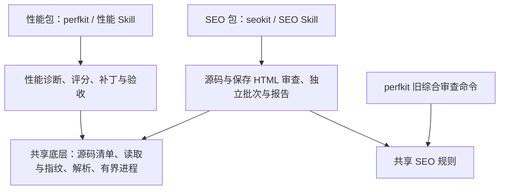

# SEO 与性能评分独立工具（0.17.0）

第一轮交付两个可独立安装的源码 ZIP。性能工具保留 `perfkit` 和全部原命令；SEO 工具提供 `seokit`。两包无需互相安装或引用兄弟目录。维护时公共代码只在 `lib/core` 保存一份，构建时按显式清单复制；SEO 规则在 `lib/seo/source-rules.mjs` 同时供旧 audit-quality 和新入口调用。

图中为仓库的维护依赖；发行时各包包含自己所需的模块，不需要第三个共享包或兄弟目录。

## 独立使用

| 任务 | 入口 | 结果边界 |
| --- | --- | --- |
| 源码 SEO 声明审查 | `seokit audit-source --project /absolute/theme --out /absolute/task/seo.json` | 源码候选与观察，动态结果待验证 |
| 保存的整页 HTML | `seokit audit-html --input /absolute/task/page.html --out /absolute/task/seo-html.json` | 文件字节绑定，店铺与部署未证明 |
| 保存的 Section HTML | 上述命令加 `--fragment true` | 不要求整页元数据，检查片段误输出 |
| 一次处理多个输入 | `seokit batch --config /absolute/config.json --out /absolute/new-run` | 无 measurement/run 依赖，逐项保留结果 |
| SEO HTML 报告 | `seokit report --input /absolute/task/seo.json --out /absolute/task/seo.html` | 仅接收 SEO 审查契约 |
| SEO PDF 报告 | `seokit report-pdf --input /absolute/task/seo.json --out /absolute/task/seo.pdf` | 需可选 reportlab，保留未知及覆盖范围 |
| 性能诊断与提分 | `perfkit` 的 batch、optimize、improve、verify-* | 原正式测量和完整优化门槛保持 |

从源码或解压目录运行时，可将 `seokit` 替换为 `node scripts/seokit.mjs`。HTML/PDF 解释器依次使用 `SEOKIT_PYTHON`、`PERF_KIT_PYTHON`、`python3`。源码审查无第三方运行依赖，修复需 npm ci 安装锁定的 Shopify Liquid 解析器；Python HTML helper 只使用标准库。`doctor` 检查 Python 3.9+ 是否可用，缺少 Python 不影响源码审查；PDF 依赖在实际渲染时验证。

批次配置 schemaVersion 为 1，只接受 project、renderedHtml、timeoutMs。project 和 renderedHtml 至少提供一个；renderedHtml 为 1–12 个 `{input,fragment?}`，路径绝对，fragment 为布尔值。timeoutMs 为 100–3600000 毫秒，默认 120000。总时限涵盖每个独立子进程；不提供测分、在线爬取、修改主题或自动重试选样能力。

输出目录必须为新目录，报告必须为新文件，且位于工具及主题目录之外。批次写 batch.json、逐项 seo-N.json/html 和 index.html。后续输入失败时，已有报告及 completed/inputs 保留。运行状态、问题数与验收分别表示；退出 0 为声明的离线检查完整且无发现，3 为有发现/覆盖不完整/超时停止，2 为配置或执行失败。

## 证据与检查范围

源码检查复用原元数据、静态 JSON-LD、robots/hreflang 声明、链接与原生图片 alt 规则；布局通过字面 render/include 闭包检查。JS/CSS 语法或生命周期问题不会被塞进 SEO 结论。主题清单读取失败、未扫描源文件、动态/缺失 snippet 和无可读 layout 保留不完整状态。主题源码扫描结束后重查指纹，漂移时终止。

HTML 的 SEO profile 保留元数据、JSON-LD、图片源/alt、重复 id、语言和标题层级观察；阻塞脚本、尺寸和样式加载问题继续属于性能/兼容检查。先分组，再统计和截断；最多保留 200 项详情，完整计数与截断标志保留，截断不能报告为完整审查。

结果 `kind=seo-audit`、`domain=seo`、`ruleVersion=1`；source 模式绑定本地源码清单，html 模式保留 `unverified-saved-html`。`acceptance=not-evaluated` 在本轮始终成立。报告渲染重核计数、状态与指纹关系，不接受性能结果或伪造的干净汇总。哈希只用于一致性，不是签名或来源认证。

新增源码修复验收 source-fix-verified，见 [修复流程](source-repair-workflow.md)；没有 SEO 线上验收或自定义 SEO 分数。HTTP/X-Robots-Tag、robots/sitemap、hreflang 互返和 Rich Results 资格仍需后续证据。完整页面与 fragment 不混用；HTML 行号不能当成 Liquid 行号。可访问性和标题层级观察也不推断排名结果。

## 兼容与共享边界

旧 `perfkit audit-quality`、`audit-html`、`batch`、`report-pdf` 保持原综合内容和退出语义。旧 batch 显式启用诊断后仍可能因待复核项退出 3，即使评分已达标；独立 SEO 使用 seokit。`verify-site`、`score-target`、`verify-optimization` 继续只消费原性能契约，SEO 报告不能代替它们的证据。

源码遍历/依赖解析、读取/指纹、HTML/Liquid 词法、HTML helper、有界进程及 HTML 转义共享。SEO 不依赖 performance、measure、recovery 或浏览器包。两者共用 lib/core/source-write 的源码写入、冲突保护和回滚机制；SEO 使用独立计划与源码验收契约，不依赖性能会话。SEO 与性能需串行修改同一主题。

根目录 `SKILL.md` 面向性能与提分；SEO 发行包根目录有独立 `SKILL.md` 和 agents/openai.yaml。安装两个不同名称的完整目录即可，不覆盖已有技能。

## 构建与验证

仓库根目录执行 `npm run release:toolkits -- --out-dir /absolute/Codex-Outputs/new-release-directory`，生成两个 ZIP、逐包 SHA-256 和 release-manifest.json。旧 `npm run release -- --out /absolute/new-perf.zip` 保留。SEO staging 采用 packages/seo/release-map.json，版本与锁文件必须一致，拒绝路径逃逸、符号链接和覆盖旧产物。

测试包括独立 SEO CLI/批次、旧检查器等价性、性能报告不接受 SEO 输入、截断和部分失败、总时限与子进程退出、报告路径保护、无跨产品依赖、构建路径/版本/覆盖反例及包内实际安装/执行。最终解包在新目录各自 npm ci；SEO 测试不依赖另一个包。生成记录和测试日志保存在仓库外。

## 拆分复审补充

源码元数据审查排除 SVG 标题及 template/noscript 中的惰性标记，这些内容不能抵消页面声明缺失。规则仍属静态候选，不推断运行时插入结果。报告读取同时核对覆盖状态、布局与观察的源码归属，以及 HTML 截断时保留的 200 项详情；JSON 字段顺序不影响校验。共享模块只能依赖 Node 内置模块或同层模块，不得反向引用 SEO 或性能层。双包构建同时核对两套锁文件版本。
